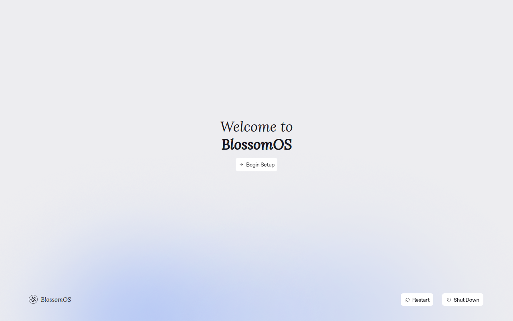
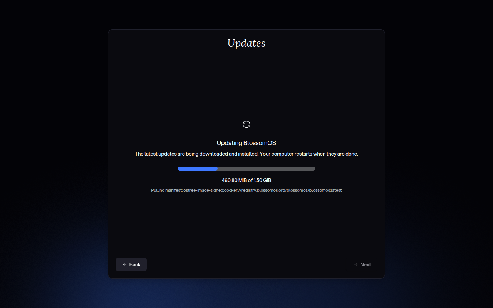
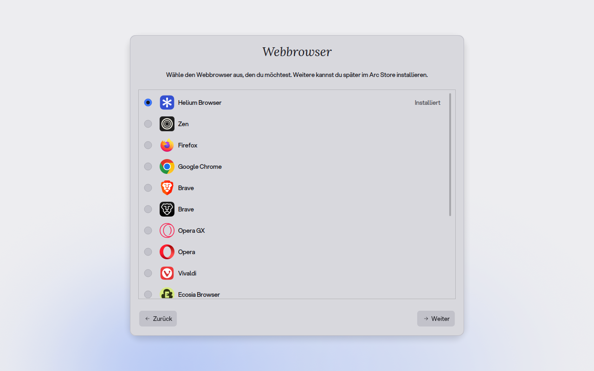

<div align="center">

  # plasma-setup-blossomos

  BlossomOS build of [Plasma Setup](https://invent.kde.org/plasma/plasma-setup), the first-boot wizard, published to [repo.blossomos.org/rpm](https://repo.blossomos.org/rpm/)
</div>

---

Fedora's `plasma-setup` package with the patches in `patches/` on top. Fedora's own downstream patches (its look and feel and wallpaper) are dropped, since ours replace them.

## Screenshots



| Updates page (dark) | Web browser page |
|---|---|
|  |  |

## Usage

```
just preview          # try the wizard in a window, nothing on this system changes
just preview --dark   # same, starting in dark mode
just preview --page appearance  # straight to a page (the end of its plugin id)
just rpm              # build the RPM (build/rpmbuild/RPMS/)
just                  # list everything
```

`./build.sh [fedora_version]` is what `just rpm` runs. It defaults to Fedora 44. It fetches the latest plasma-setup SRPM from Koji (cached in `cache/`) and edits the spec as follows:
- drops Fedora's patches
- adds ours as `Patch2000+`, applied with `%autosetup -S git` because some patches carry binary files
- swaps `plasma-lookandfeel-fedora` for the BlossomOS theme packages
- appends `.blossomos1` to the release
- installs `wallpapers.json` (see below)

It then installs build dependencies via `dnf builddep` and runs `rpmbuild`.

### Preview

`just preview` builds `build/src` into `build/stage` and runs it in a nested KWin window:
- It uses a throwaway home, seeded like the real setup session's.
- It runs on a private session bus.
- It sets `PLASMA_SETUP_PREVIEW=1`. With that set, the wizard doesn't create the user, mark setup as done, log out, restart, shut down, or set the hostname, time zone, language, keyboard layout or Wi-Fi.

The Dark Theme switch and the accent colour really apply and only change the preview. `just screenshot out.png [--dark] [--page NAME]` saves the landing page, or that page.

## Wallpapers

`wallpapers.json` lists what the appearance page offers, by folder name in `/usr/share/wallpapers`, and which one is preselected:

```json
{
    "default": "Blossom Rays",
    "wallpapers": ["Blossom Rays", "Next", "Flow"]
}
```

It is installed as `/usr/share/plasma-setup/wallpapers.json`. Entries that aren't installed are skipped, and with fewer than two left the page shows no wallpapers.

## Changing the patches

```
just source           # build/src: upstream as a git tree, patches/ applied as commits
# edit in build/src, then either
just patch "Add a foo page"  # commit the changes as a new patch
just patch 12                # or fold them into patch 0012
```

`just patch` commits what's staged in `build/src`, or everything when nothing is, and writes the commits back to `patches/`. To write a longer message or reword a patch, commit in `build/src` yourself and run `just export-patches`.

The upstream tree installs a clang-format pre-commit hook. Run `git clang-format --staged` if it complains.

## Patches

| # | Patch | Purpose |
|---|-------|---------|
| 0001 | BlossomUI look and feel | The Dark Theme switch applies `org.blossomos.ui.{light,dark}.desktop` instead of Breeze. It then re-asserts what the look and feel packages leave out or get wrong: the colour scheme name, the Bibata-Modern-Classic cursor at 20px and `blossom-sound-theme`. |
| 0002 | Merge the theme into the new user | Upstream copies the setup user's `kdeglobals` over the new account's, which wiped what `/etc/skel` put there. Now the theme is merged in and the scheme is named after the chosen look and feel, so light/dark actually reaches the user session. The Bibata 20px cursor is set too, and the GTK 3/4 `settings.ini` gets BlossomUI, the cursor, the sound theme and the dark preference. |
| 0003 | Setup session defaults | The temporary `plasma-setup` session gets the skel's `kdeglobals`, `kcminputrc`, `plasmarc` and `ksplashrc`: BlossomUI, the cursor, the sound theme and no splash. blossom-welcome is hidden there; the new user still sees it on first login. |
| 0004 | BlossomOS Recovery look | Recovery's animated glow backdrop replaces the wallpaper, with a light variant that follows the app's colours. Recovery's window becomes the step card. Also: Lora headings, the BlossomOS mark, the BlossomUI Qt Quick style, and the German "Welcome to %1". |
| 0005 | Remove the KDE mascots | Konqi on the finished page becomes Recovery's green check badge. The app icon becomes `blossomos-logo`. |
| 0006 | Preview mode | `PLASMA_SETUP_PREVIEW=1` (see above), and `PLASMA_SETUP_PREVIEW_PAGE` to walk straight to a page. Pages installed in two data dirs are listed once. |
| 0007 | German: du | The German translation addresses the user with du instead of Sie, including the account page title ("Über dich"). |
| 0008 | Wallpaper page | A page after the theme switch that offers the wallpapers in `wallpapers.json` as thumbnails, in their dark variant in dark mode. The pick goes on the new user's desktop along with the theme. |
| 0009 | Updates page | After the network page: downloads and stages the latest system image through rpm-ostree, with progress, and restarts right away when there was one (setup then starts again). Setup goes on once up to date, or when updating failed. Skipped without internet: pages can now skip themselves with `skipPage()`. The setup user may upgrade and restart without a password. |
| 0010 | Web browser page | After the updates page: offers the browsers on the Forge browser list (the one the Arc Store shows) as radio buttons. The chosen one is installed right away as a system-wide Flatpak and becomes the new user's default (`mimeapps.list`, kdeglobals), then the others on the list are removed; setup only goes on with one chosen. Skipped without internet. The setup user may install Flatpak apps and runtimes, and remove apps, without a password. |
| 0012 | Appearance page | The Dark Theme switch moves onto the wallpaper page, now the Appearance page; the "Before we get started" page isn't built any more. It adds an accent colour row with quick-appearance-kcm's palette, baked into kdeglobals the same way (picking BlossomUI's own blue clears it), which reaches the new user with the theme. The wallpaper goes on the desktop, the lock screen (`kscreenlockerrc`) or both. Once one is picked it replaces the glow behind setup, crossfading on each change. The glow itself crossfades to a new accent colour over 5 seconds instead of blinking. Like the account page, it isn't shown when there are users already. |
| 0013 | Encryption page | After the web browser page: when the data was encrypted at install time, offers to unlock the disk automatically on start ("Festplatte automatisch entsperren"), worded as a convenience. It enrolls the TPM like `ujust tpm enroll` does (`systemd-cryptenroll --tpm2-device=auto`, PCR 7), and the passphrase keeps working. Only offered when `/etc/crypttab` has a LUKS2 disk without a TPM unlock yet, the TPM 2.0 is usable (`systemd-analyze has-tpm2`) and Secure Boot is on; otherwise skipped. The passphrase is checked with cryptsetup first. The setup user may list and enroll the disks without a password, the helper picks the disks itself. |
